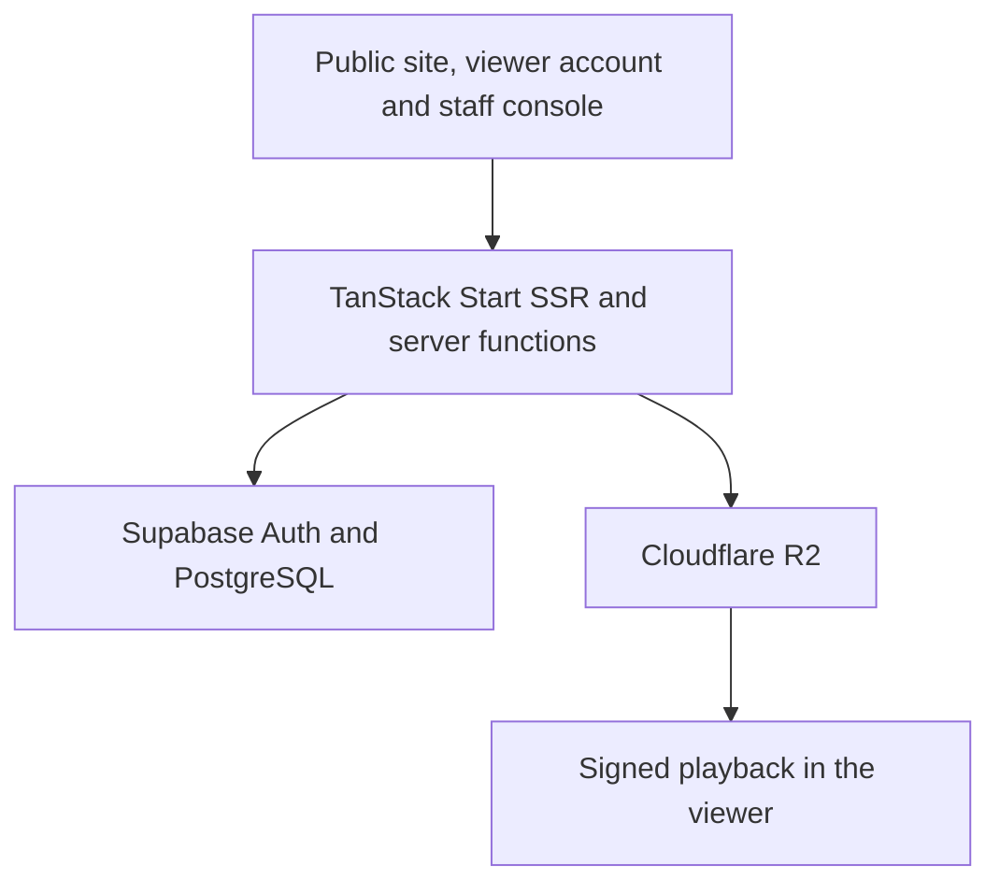

<h1 align="center">
  
</h1>

  <strong>An on-demand streaming platform for Branta Films' AI-generated Bangladeshi web series.</strong>

  <a href="https://films.brantatech.com/"><strong>Live website</strong></a> ·
  <a href="#catalogue-and-viewer-experience">Catalogue</a> ·
  <a href="#checkout-and-access">Checkout</a> ·
  <a href="#playback-and-media">Playback</a> ·
  <a href="#staff-console">Staff console</a> ·
  <a href="#technology">Stack</a>

## Project overview

Branta Films gives Branta Tech a home for publishing and streaming its AI-generated web series. A viewer can discover a title, read the series and episode pages, sign in to watch an available free episode, or purchase access to an individual episode or a full series. Staff use the same platform to publish releases, upload video, manage offers, review payments and support viewers.

**Shanti Nibash** is a featured release. The public series page brings together the poster, synopsis, season and episode list, runtimes and access options. The README cover uses its published artwork, the Branta Films wordmark treatment and Shahriar Nabil's developer mark. [View Shanti Nibash](https://films.brantatech.com/series/shantinibash)

## Catalogue and viewer experience

| Experience | What the platform supports |
| --- | --- |
| [Home](https://films.brantatech.com/) | A featured carousel introduces published releases. The homepage also has catalogue rows and genre discovery. [Home route](src/routes/index.tsx) |
| [Browse](https://films.brantatech.com/browse) | Search by title or filter by genre. Responsive artwork, episode counts, release information and prices help viewers compare titles. [Browse route](src/routes/browse.tsx) |
| Series and episode pages | Shareable detail pages show synopses, artwork, release metadata, runtimes and available viewing or purchase actions. They are rendered from published catalogue records. [Series page](src/routes/series.$slug.tsx) · [Episode page](src/routes/episode.$episodeId.tsx) |
| Viewer dashboard | An authenticated workspace brings together Explore, Continue Watching, the viewer's library, order history, profile and sign-in settings. [Account routes](src/routes/_authenticated) |
| Brand and responsive UI | Branta Orange (`#FF5D00`), dark cinema surfaces, Geist and Geist Mono sit alongside SolaimanLipi and Kalpurush for Bangla text. The public site has mobile navigation and the staff console uses its own dashboard layout. [Design tokens](src/styles.css) · [Brand logo](src/components/brand/Logo.tsx) |

## Checkout and access

1. **Choose an episode or a series.** The cart removes duplicate selections and excludes episodes already covered by a series in the same cart. The server also checks publication state, existing access and pending orders. [Cart rules](src/lib/cart-pricing.ts) · [Server quote](src/lib/commerce.server.ts)
2. **Calculate the price in BDT.** The platform can apply scheduled offers or a typed coupon. It evaluates eligibility, minimum spend, usage limits and caps, and applies the best eligible discount to each line. Checkout recalculates the amount from database values and asks for a refreshed quote if pricing changes. [Pricing engine](src/lib/cart-pricing.ts) · [Order submission](src/lib/commerce.functions.ts)
3. **Submit a mobile payment for review.** Checkout shows configured bKash and Nagad options. The viewer submits the sender's number and transaction ID. The app records a pending order with a snapshot of its line items and the database enforces a unique transaction ID per payment method. [Checkout route](src/routes/_authenticated/checkout.tsx)
4. **Verify and unlock.** An administrator reviews the payment and approves or rejects the order. Approval grants the purchased series or episode entitlement. The viewer sees the decision in their order history and can watch with the granted access. [Payment review](src/lib/commerce-admin.functions.ts) · [Viewer orders](src/routes/_authenticated/account.orders.tsx)

## Playback and media

| Area | Implementation |
| --- | --- |
| Playback entitlement | The server checks the authenticated account, publication status and series or episode access. Published free episodes are available to signed-in viewers. Paid episodes require the corresponding episode or series entitlement. [Access rules](src/lib/access.ts) · [Playback server](src/lib/playback.functions.ts) |
| Private video delivery | Episode video objects are stored in a private Cloudflare R2 bucket. The playback server returns a 15-minute signed link after checking access and confirming the object exists. The player refreshes expiring links and restores the playback position. [R2 integration](src/lib/r2.server.ts) |
| Player | The custom HTML video player supports seeking, playback speed, volume and fullscreen. It loads HLS.js for supported HLS sources and can select from the levels available in an HLS stream. [Video player](src/components/player/VideoPlayer.tsx) |
| Continue Watching | Progress is saved during playback, on pause and when leaving the page. It restores an unfinished episode at the saved position. Completion is based on playback position, while the staff view uses separate presence observations for watch time. [Progress data](src/lib/progress.ts) · [Watch screen](src/components/player/WatchView.tsx) |
| Artwork | An image-only proxy serves allowed R2 artwork paths. The catalogue requests responsive Cloudflare image variants with an original-image fallback. [Image proxy](src/routes/api/public/media.$.ts) · [Artwork component](src/components/catalog/ArtworkImage.tsx) |

## Identity and account controls

- **Viewer access.** Supabase Auth handles email and password, six-digit email verification and password recovery, and Google OAuth. Google One Tap can be enabled with a configured client ID. Turnstile is shown when Supabase requests a CAPTCHA. [Sign-in route](src/routes/auth.tsx) · [Google One Tap](src/components/auth/GoogleOneTap.tsx) · [Password recovery](src/routes/forgot-password.tsx)
- **Passkeys.** SimpleWebAuthn verifies registration and sign-in challenges. The app offers optional enrollment after a fresh sign-in and lists registered passkeys in account security. [Passkey server](src/lib/passkey.functions.ts) · [Account security](src/routes/_authenticated/account.security.tsx)
- **Staff roles.** Staff accounts are invited into the administrator or manager role. Administrators have protected management tools. The playback rules allow role-verified staff previews. [Roles and permissions](src/lib/admin-rules.ts) · [Staff invite route](src/routes/set-password.tsx)
- **Account enforcement.** Server middleware validates Supabase claims and checks restrictions and revoked sessions before protected operations. PostgreSQL row-level security scopes catalogue visibility and account records. Viewer history and staff audit actions are handled separately from the public catalogue. [Account middleware](src/lib/security-middleware.ts) · [Supabase migrations](supabase/migrations)

## Staff console

| Workspace | Tools |
| --- | --- |
| Series and episodes | Create drafts, edit metadata and sanitized rich text, crop artwork, reorder episodes within their series, publish content and choose featured titles. [Series editor](src/routes/_authenticated/admin.series.$id.tsx) |
| Video operations | Upload directly to R2 with signed multipart requests, resumable parts and progress reporting. On finalization, the server reads the MP4 duration and attaches the video. A cleanup queue handles replaced video objects. Staff preview media without recording viewer progress. [Upload hook](src/hooks/use-video-upload.ts) · [Media operations](src/lib/admin.functions.ts) |
| Payments and entitlements | Review pending orders, approve or reject submissions, configure payment methods and manage series access. [Payment queue](src/routes/_authenticated/admin.orders.tsx) · [Series access](src/routes/_authenticated/admin.unlocks.tsx) |
| Offers and promotions | Manage coupon codes and automatic offers, target titles or episodes, set validity and usage limits, and schedule promotional popups for the site or dashboard. [Coupon tools](src/routes/_authenticated/admin.coupons.tsx) · [Popup tools](src/routes/_authenticated/admin.popups.tsx) |
| People and support | Invite staff, inspect viewer sessions and watch history, review restrictions and open a read-only view of a viewer's account using the administrator's own identity. [People operations](src/lib/people.functions.ts) · [Support preview](src/routes/_authenticated/admin.view-as.$id.tsx) |

## Architecture

- **Application.** TanStack Start renders public routes on the server, TanStack Router organizes the site and workspaces, and TanStack Query manages data loading and mutations. Nitro supplies the server runtime with a Cloudflare module preset as the default. [Router](src/router.tsx) · [Vite configuration](vite.config.ts) · [Server entry](src/server.ts)
- **Data and access.** PostgreSQL models published series and episodes, private media references, orders, entitlements, watch progress, passkeys and access controls. Supabase Auth and row-level security provide identity and record-level authorization. Privileged operations use a server-only Supabase client. [Database migrations](supabase/migrations) · [Supabase integration](src/integrations/supabase)
- **Media lifecycle.** Staff upload video parts directly to R2, the server records the finalized media reference, and authorized viewers receive time-limited playback URLs. Public catalogue reads return content metadata, and artwork is served through its image route. [Upload hook](src/hooks/use-video-upload.ts) · [Catalogue server](src/lib/catalog.functions.ts)
- **Search and sharing.** Public series and episode pages include canonical URLs, Open Graph metadata and `TVSeries` or `TVEpisode` structured data. Staff can set metadata overrides. The XML sitemap is generated from route settings and published content. [SEO helpers](src/lib/content-seo.ts) · [Live sitemap](https://films.brantatech.com/sitemap.xml)

## Technology

The versions below come from [`bun.lock`](bun.lock). The manifest contains 68 application dependencies and 24 development dependencies.

| Layer | Technology |
| --- | --- |
| Web application | TanStack Start `1.168.60`, TanStack Router `1.170.41`, TanStack Query `5.101.4`, React and React DOM `19.2.8` |
| Build and runtime | TypeScript `5.9.3`, Vite `8.1.5`, Nitro `3.0.260603-beta`, Bun lockfile |
| Data and identity | Supabase JS `2.118.0`, PostgreSQL and RLS, Drizzle ORM `0.45.4`, SimpleWebAuthn browser `13.3.0` and server `13.3.3` |
| Video and storage | Cloudflare R2, AWS4Fetch `1.0.20`, HLS.js `1.7.3`, Mediabunny `1.62.0` |
| Interface and editing | Tailwind CSS `4.3.3`, Radix UI, Tiptap `3.32.0`, dnd-kit, Embla Carousel `8.6.0`, React Easy Crop `6.2.4` and Lucide React `0.575.0` |
| Input and verification | Zod `3.25.76`, xss `1.0.16`, React Hook Form `7.83.0`, Vitest `4.1.11` and Testing Library React `16.3.3` |

All locked direct dependencies

| Package | Locked version | Group |
| --- | --- | --- |
| `@dnd-kit/core` | `6.3.1` | Application |
| `@dnd-kit/modifiers` | `9.0.0` | Application |
| `@dnd-kit/sortable` | `10.0.0` | Application |
| `@dnd-kit/utilities` | `3.2.2` | Application |
| `@hookform/resolvers` | `5.5.7` | Application |
| `@radix-ui/react-accordion` | `1.2.20` | Application |
| `@radix-ui/react-alert-dialog` | `1.1.23` | Application |
| `@radix-ui/react-aspect-ratio` | `1.1.15` | Application |
| `@radix-ui/react-avatar` | `1.2.6` | Application |
| `@radix-ui/react-checkbox` | `1.3.11` | Application |
| `@radix-ui/react-collapsible` | `1.1.20` | Application |
| `@radix-ui/react-context-menu` | `2.3.7` | Application |
| `@radix-ui/react-dialog` | `1.1.23` | Application |
| `@radix-ui/react-dropdown-menu` | `2.1.24` | Application |
| `@radix-ui/react-hover-card` | `1.1.23` | Application |
| `@radix-ui/react-label` | `2.1.15` | Application |
| `@radix-ui/react-menubar` | `1.1.24` | Application |
| `@radix-ui/react-navigation-menu` | `1.2.22` | Application |
| `@radix-ui/react-popover` | `1.1.23` | Application |
| `@radix-ui/react-progress` | `1.1.16` | Application |
| `@radix-ui/react-radio-group` | `1.4.7` | Application |
| `@radix-ui/react-scroll-area` | `1.2.18` | Application |
| `@radix-ui/react-select` | `2.3.7` | Application |
| `@radix-ui/react-separator` | `1.1.15` | Application |
| `@radix-ui/react-slider` | `1.4.7` | Application |
| `@radix-ui/react-slot` | `1.3.3` | Application |
| `@radix-ui/react-switch` | `1.3.7` | Application |
| `@radix-ui/react-tabs` | `1.1.21` | Application |
| `@radix-ui/react-toggle` | `1.1.18` | Application |
| `@radix-ui/react-toggle-group` | `1.1.19` | Application |
| `@radix-ui/react-tooltip` | `1.2.16` | Application |
| `@simplewebauthn/browser` | `13.3.0` | Application |
| `@simplewebauthn/server` | `13.3.3` | Application |
| `@supabase/supabase-js` | `2.118.0` | Application |
| `@tailwindcss/vite` | `4.3.3` | Application |
| `@tanstack/react-query` | `5.101.4` | Application |
| `@tanstack/react-router` | `1.170.41` | Application |
| `@tanstack/react-start` | `1.168.60` | Application |
| `@tanstack/router-plugin` | `1.168.42` | Application |
| `@tiptap/extension-text-align` | `3.32.0` | Application |
| `@tiptap/extension-text-style` | `3.32.0` | Application |
| `@tiptap/react` | `3.32.0` | Application |
| `@tiptap/starter-kit` | `3.32.0` | Application |
| `aws4fetch` | `1.0.20` | Application |
| `class-variance-authority` | `0.7.1` | Application |
| `clsx` | `2.1.1` | Application |
| `cmdk` | `1.1.1` | Application |
| `date-fns` | `4.4.0` | Application |
| `embla-carousel-react` | `8.6.0` | Application |
| `hls.js` | `1.7.3` | Application |
| `input-otp` | `1.4.2` | Application |
| `lucide-react` | `0.575.0` | Application |
| `mediabunny` | `1.62.0` | Application |
| `react` | `19.2.8` | Application |
| `react-day-picker` | `9.14.0` | Application |
| `react-dom` | `19.2.8` | Application |
| `react-easy-crop` | `6.2.4` | Application |
| `react-hook-form` | `7.83.0` | Application |
| `react-resizable-panels` | `4.12.2` | Application |
| `recharts` | `2.15.4` | Application |
| `sonner` | `2.0.7` | Application |
| `tailwind-merge` | `3.6.0` | Application |
| `tailwindcss` | `4.3.3` | Application |
| `tw-animate-css` | `1.4.0` | Application |
| `vaul` | `1.1.2` | Application |
| `vite-tsconfig-paths` | `6.1.1` | Application |
| `xss` | `1.0.16` | Application |
| `zod` | `3.25.76` | Application |
| `@eslint/js` | `9.39.5` | Development |
| `@tanstack/devtools-vite` | `0.8.3` | Development |
| `@testing-library/jest-dom` | `6.10.0` | Development |
| `@testing-library/react` | `16.3.3` | Development |
| `@types/node` | `22.20.1` | Development |
| `@types/react` | `19.2.17` | Development |
| `@types/react-dom` | `19.2.3` | Development |
| `@vitejs/plugin-react` | `5.2.0` | Development |
| `drizzle-kit` | `0.31.11` | Development |
| `drizzle-orm` | `0.45.4` | Development |
| `eslint` | `9.39.5` | Development |
| `eslint-config-prettier` | `10.1.8` | Development |
| `eslint-plugin-prettier` | `5.5.6` | Development |
| `eslint-plugin-react-hooks` | `5.2.0` | Development |
| `eslint-plugin-react-refresh` | `0.4.26` | Development |
| `globals` | `15.15.0` | Development |
| `jsdom` | `20.0.3` | Development |
| `nitro` | `3.0.260603-beta` | Development |
| `postgres` | `3.4.9` | Development |
| `prettier` | `3.9.6` | Development |
| `typescript` | `5.9.3` | Development |
| `typescript-eslint` | `8.65.0` | Development |
| `vite` | `8.1.5` | Development |
| `vitest` | `4.1.11` | Development |

## Repository guide

| Path | Contents |
| --- | --- |
| [`src/routes/`](src/routes) | Public catalogue, series and episode pages, account and staff routes, checkout and the artwork endpoint. |
| [`src/components/`](src/components) | Site shell, catalogue, player, account interface, checkout and admin components. |
| [`src/lib/`](src/lib) | Business rules, server functions, media access, R2 signing, authentication and SEO. |
| [`src/integrations/supabase/`](src/integrations/supabase) | Supabase clients, auth middleware and database types. |
| [`supabase/migrations/`](supabase/migrations) and [`drizzle/`](drizzle) | PostgreSQL migrations and schema tooling. |
| [`docs/readme/`](docs/readme) | Branta Films case-study cover and developer mark. |

## Credits

  

**Shahriar Nabil** · CTO, Branta Tech · [Portfolio](https://shahnabil.com/) · [GitHub](https://github.com/ShahNabil1)

**Branta Films** · [Streaming site](https://films.brantatech.com/) · [Branta Tech](https://brantatech.com/)

[Privacy policy](https://films.brantatech.com/privacy) · [Terms of service](https://films.brantatech.com/terms)
